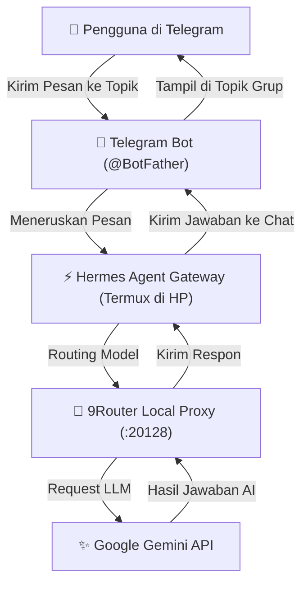

# GDG Yogya 2026: Workshop AI Hermes on Pocket

Selamat datang di workshop **AI Hermes on Pocket**! Di sini, Anda akan belajar cara membangun asisten AI mandiri (**Hermes Agent**) yang berjalan langsung di dalam saku (smartphone Android) Anda menggunakan **Termux**, ditenagai oleh **Google Gemini API** melalui **9Router**, dan dapat diajak berinteraksi kapan saja melalui **Telegram** lengkap dengan fitur **Topics (Forum)**.

## 👨‍💻 Pemateri (Speaker)
- **Jefri Herdi Triyanto, S.T., C.Me** — *CEO PT. Sawang Teknologi Indonesia & Principal Software Engineer*
- 🔗 **LinkedIn**: [linkedin.com/in/jefri-herdi-triyanto](https://id.linkedin.com/in/jefri-herdi-triyanto)
- 📸 **Instagram**: [@jefripunza](https://instagram.com/jefripunza)

---

## 🎯 Gambaran Cara Kerja Sistem

Berikut adalah alur bagaimana pesan Anda diproses oleh AI langsung dari smartphone Anda:



---

## 📋 Persiapan Sebelum Mulai

Pastikan Anda telah menyiapkan hal-hal berikut sesuai perangkat yang Anda gunakan:

### 🔑 Kebutuhan Umum (Wajib untuk Semua Peserta)
1. **Google Gemini API Key**: Dapatkan API Key gratis di [Google AI Studio](https://aistudio.google.com/).
2. **Akun Telegram Aktif**: Digunakan untuk membuat Bot melalui `@BotFather` dan ruang obrolan asisten AI berfitur **Topics**.
3. **Koneksi Internet**: Diperlukan untuk mengunduh paket/container dan terhubung ke API Gemini & Telegram.

### 📱 Jalur 1 — Pengguna Smartphone Android
1. **Aplikasi Termux**: Unduh dan pasang dari [F-Droid](https://f-droid.org/en/packages/com.termux/) *(Penting: jangan gunakan versi Google Play Store karena sudah usang dan tidak diperbarui)*.
2. **Pengaturan Baterai**: Disarankan mengatur izin penggunaan baterai aplikasi Termux ke **"Unrestricted" / "Tidak Dibatasi"** agar proses AI tetap hidup di latar belakang saat layar terkunci.

### 💻 Jalur 2 — Pengguna Laptop (macOS, Linux, atau Windows / Pengguna iOS)
1. **Docker & Docker Compose**:
   - **Windows / macOS**: Unduh, pasang, dan pastikan aplikasi **[Docker Desktop](https://www.docker.com/products/docker-desktop/)** sudah menyala (*running*).
   - **Linux**: Pastikan **Docker Engine** dan plugin **`docker compose`** sudah terpasang serta layanan daemon Docker sudah aktif (`sudo systemctl start docker`).
2. **Aplikasi Terminal**:
   - **macOS / Linux**: Gunakan aplikasi **Terminal** bawaan (`bash` / `zsh`) dengan `curl` terpasang.
   - **Windows**: Gunakan **PowerShell** atau **Command Prompt (CMD)** bawaan Windows.

---

## 🚀 Panduan Langkah demi Langkah

### Langkah 1: Instalasi Sekali Jalan (`mobile.sh`)

Buka aplikasi **Termux** di smartphone Anda, lalu cukup salin dan jalankan perintah satu baris (one-liner) berikut:

```bash
curl -fsSL https://raw.githubusercontent.com/jefripunza/gdg-yogya-2026-workshop-ai-hermes-on-pocket/master/mobile.sh | bash
```

> **Apa yang dilakukan oleh script ini secara otomatis?**
> - Mengaktifkan izin wakelock (`termux-wake-lock`) secara otomatis agar proses tetap berjalan di background saat layar mati.
> - Menginstal paket dasar Termux dan Node.js versi terbaru.
> - Mengunduh dan memasang **Hermes Agent** (Nous Research).
> - Menginstal **9Router** secara global via npm.
> - Mengunduh script helper konfigurasi (**`hc.sh`** dan **`ht.sh`**) langsung ke direktori home Termux Anda.
> - Mengaktifkan fitur **Auto-Start**: Setiap kali Termux dibuka kembali, 9Router dan Hermes Gateway akan otomatis menyala di background tanpa terjadi proses ganda (anti-duplikasi).

---

### Langkah 2: Konfigurasi 9Router & Gemini API

Setelah script selesai berjalan:

1. Buka browser di smartphone Anda (Chrome / Firefox).
2. Buka alamat: **`http://localhost:20128`**
   - Masukkan password default: **`123456`**
3. Masuk ke menu **Providers**:
   - Pilih provider **Google / Gemini**.
   - Masukkan **Gemini API Key** yang sudah Anda dapatkan dari Google AI Studio.
4. Masuk ke menu **Combos**:
   - Klik **Create Combo**.
   - Beri nama combo: `gdg-yogya`
   - Pilih model (contoh: `gemini-2.0-flash` atau `gemini-1.5-pro`).
   - Simpan combo.
5. Masuk ke menu **API Keys**:
   - Klik **Generate API Key**.
   - Salin (copy) API Key yang muncul (dimulai dengan `9r-...`).

---

### Langkah 3: Hubungkan Hermes ke 9Router (`hc.sh`)

Kembali ke aplikasi **Termux**, lalu jalankan script konfigurasi Hermes:

```bash
./hc.sh gdg-yogya <paste-api-key-9router-anda>
```

*Contoh:*
```bash
./hc.sh gdg-yogya 9r-abc123xyz789
```

> Script ini secara otomatis mengonfigurasi Hermes agar berkomunikasi dengan 9Router lokal dan merestart Hermes Gateway dengan setelan baru.

#### 🧪 Uji Coba Chat Pertama:
Buka browser HP Anda ke alamat **`http://localhost:9119`** untuk membuka antarmuka web Hermes. Coba kirimkan pesan sapaan seperti *"Halo Hermes, perkenalkan dirimu!"* untuk memastikan AI sudah merespon dengan baik.

---

### Langkah 4: Integrasikan ke Telegram (`ht.sh`)

Sekarang saatnya menghubungkan AI Anda ke Telegram agar bisa diakses kapan saja:

1. Buka aplikasi **Telegram**, cari akun resmi **`@BotFather`**.
2. Ketik perintah: `/newbot`
3. Beri nama bot Anda (misal: `My Pocket Hermes`) dan username bot yang berakhiran `bot` (misal: `hermes_pocket_bot`).
4. `@BotFather` akan memberikan **HTTP API Token** (format: `123456789:ABCdefGHIjklMNOpqrSTUvwxYZ`). Salin token tersebut.
5. Kembali ke **Termux**, lalu jalankan script integrasi Telegram:

```bash
./ht.sh <paste-token-telegram-anda>
```

> **Tips Keamanan (Opsional):** Script akan menanyakan User ID Telegram Anda untuk whitelist. Anda bisa mengecek User ID Anda di Telegram lewat bot `@userinfobot`. Jika tidak ingin dibatasi, tekan `[Enter]`.

---

### Langkah 5: Buat Forum Group Telegram dengan Topik Produktif

Agar asisten AI Anda semakin rapi dan terorganisir:

1. Di Telegram, **Buat Grup Baru** (misal: *"Hermes Pocket Lab"*).
2. Masukkan bot Telegram Anda ke dalam grup tersebut dan **Jadikan sebagai Admin** (Wajib agar bot memiliki izin membaca pesan di dalam grup).
   > **Catatan Penting untuk Grup**:
   > - Secara bawaan Telegram, bot hanya bisa membaca pesan di grup jika dijadikan **Admin**, atau jika Anda memanggilnya dengan **mention** (`@nama_bot pesan`), atau jika Anda me-reply pesan bot.
   > - Agar bot bisa merespons semua pesan di grup tanpa perlu dijadikan Admin atau di-mention: buka `@BotFather` -> ketik `/setprivacy` -> pilih bot Anda -> pilih **`Disable`**.
3. Buka **Info Grup** -> pilih **Edit (ikon pensil)** -> aktifkan menu **Topics** (Forum).
4. Buat 4 topik produktif sesuai kebutuhan Anda:
   - **`#Learning`** : Eksplorasi materi baru, rangkuman kursus, dan tanya jawab konsep mendalam.
   - **`#Research`** : Ringkasan materi, analisis paper, dan eksplorasi riset.
   - **`#Daily-Planner`** : Perencanaan jadwal harian, to-do list, dan refleksi tugas.
   - **`#Coding`** : Konsultasi arsitektur kode, debugging, dan pembuatan fungsi.

Kini Anda dapat berdiskusi di setiap topik secara terpisah, dan Hermes akan menjawab sesuai konteks topik tersebut!

---

## 🎉 Selamat!

Anda telah berhasil membangun **AI Assistant pribadi** yang hidup langsung di dalam saku smartphone Anda. AI ini selalu siap membantu Anda kapan pun dan di mana pun tanpa bergantung pada langganan server pihak ketiga!

---

## 💻 Alternatif Laptop / Non-Android (Docker Compose)

Bagi rekan-rekan peserta workshop yang **tidak menggunakan smartphone Android** (misalnya pengguna iPhone / iOS, atau yang ingin langsung mencoba di laptop Windows, macOS, atau Linux), Anda dapat menggunakan skrip otomatisasi satu baris (**one-click setup**):

Kita menggunakan image Docker resmi berikut:
- 🔄 **9Router**: [`decolua/9router`](https://hub.docker.com/r/decolua/9router) (LLM Proxy & Gateway)
- ⚡ **Hermes Agent**: [`nousresearch/hermes-agent`](https://hub.docker.com/r/nousresearch/hermes-agent) (Autonomous AI Agent)

---

### Langkah 1: Jalankan Script Setup Otomatis di Terminal Laptop

Pastikan aplikasi **Docker Desktop** sudah aktif di laptop Anda, lalu buka terminal dan jalankan perintah sesuai sistem operasi Anda:

#### 🍏 Pengguna macOS / 🐧 Linux:
Salin dan jalankan perintah satu baris berikut di terminal laptop:
```bash
curl -fsSL https://raw.githubusercontent.com/jefripunza/gdg-yogya-2026-workshop-ai-hermes-on-pocket/master/laptop.sh | bash
```
*(Atau jika sudah meng-clone repo: `./laptop.sh`)*

#### 🪟 Pengguna Windows (PowerShell):
Buka **PowerShell**, lalu salin dan jalankan perintah bawaan (native) PowerShell berikut:
```powershell
irm https://raw.githubusercontent.com/jefripunza/gdg-yogya-2026-workshop-ai-hermes-on-pocket/master/laptop.ps1 | iex
```
*(Atau jika sudah meng-clone repo: `.\laptop.ps1`)*

#### 🪟 Pengguna Windows (Command Prompt / CMD):
Buka **Command Prompt (CMD)**, lalu salin dan jalankan perintah bawaan Windows (`certutil`) berikut tanpa butuh `curl`:
```cmd
certutil -urlcache -split -f https://raw.githubusercontent.com/jefripunza/gdg-yogya-2026-workshop-ai-hermes-on-pocket/master/laptop.bat laptop.bat && laptop.bat
```
*(Atau jika sudah meng-clone repo, cukup jalankan `laptop.bat`)*

> **Apa yang dilakukan oleh script `laptop.sh` / `laptop.bat` secara otomatis?**
> - Mengunduh file `docker-compose.yml` resmi.
> - Menyalakan container `9router` dan `hermes-agent` di background via Docker Compose.
> - Mengunduh dan meng-inject file **`hc.sh`** dan **`ht.sh`** langsung ke dalam container `hermes-agent`.

---

### Langkah 2: Konfigurasi 9Router & Gemini API

1. Buka browser di laptop Anda: **`http://localhost:20128`**
2. Masukkan password default: **`123456`**
3. Masuk ke menu **Providers** -> Masukkan **Gemini API Key** Anda.
4. Masuk ke menu **Combos** -> Buat combo bernama **`gdg-yogya`** (pilih model Gemini).
5. Masuk ke menu **API Keys** -> Klik **Generate API Key** dan salin API Key tersebut (berawalan `9r-...`).

---

### Langkah 3: Hubungkan Hermes & Bot Telegram

Jalankan perintah berikut di terminal laptop Anda:

1. **Hubungkan Hermes ke 9Router (`hc.sh`)**:
   ```bash
   docker exec -it hermes-agent ./hc.sh gdg-yogya <paste-api-key-9router-anda>
   ```

2. **Hubungkan ke Bot Telegram (`ht.sh`)**:
   ```bash
   docker exec -it hermes-agent ./ht.sh <paste-token-telegram-anda>
   ```

3. **Buka Web UI Dashboard**:
   Buka browser laptop Anda ke **`http://localhost:9119`** (Masukkan Username: **`admin`** dan Password: **`123456`**) untuk berinteraksi langsung via Web Dashboard, atau buka aplikasi Telegram dan ajak bot Anda mengobrol!

---

## 💡 Troubleshooting & Tips Tambahan

- **Termux ditutup oleh sistem Android saat layar mati?**
  Pastikan baterai untuk aplikasi Termux diatur ke **"Unrestricted" / "Tidak Dibatasi"** pada setelan ponsel Anda, dan pastikan sudah menjalankan `termux-wake-lock`.
- **Melihat status service:**
  Layanan 9Router dan Hermes Gateway otomatis dicek dan dijalankan ulang setiap kali Termux dibuka. Anda bisa memantau log jika terjadi kendala:
  - Log 9Router: `cat ~/.9router/logs/9router.log`
  - Log Hermes Gateway: `cat ~/.hermes/logs/gateway.log`
- **Mengubah API Key / Model:**
  Cukup jalankan kembali `./hc.sh <nama-combo-baru> <api-key-baru>` kapan saja tanpa perlu mengulang dari awal.
