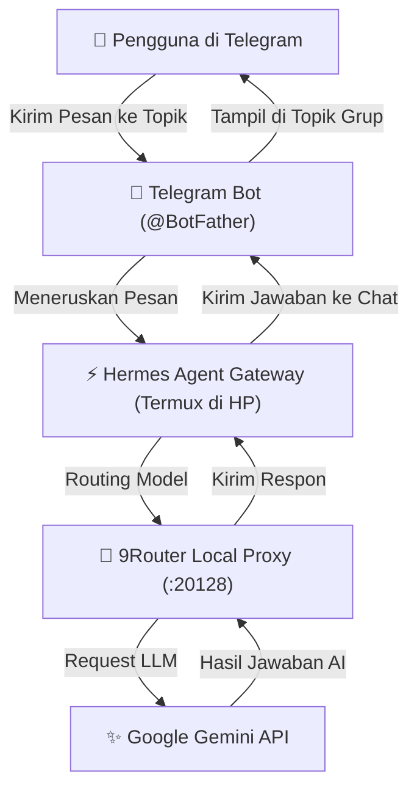

# GDG Yogya 2026: Workshop AI Hermes on Pocket

Selamat datang di workshop **AI Hermes on Pocket**! Di sini, Anda akan belajar cara membangun asisten AI mandiri (**Hermes Agent**) yang berjalan langsung di dalam saku (smartphone Android) Anda menggunakan **Termux**, ditenagai oleh **Google Gemini API** melalui **9Router**, dan dapat diajak berinteraksi kapan saja melalui **Telegram** lengkap dengan fitur **Topics (Forum)**.

---

## 🎯 Gambaran Cara Kerja Sistem

Berikut adalah alur bagaimana pesan Anda diproses oleh AI langsung dari smartphone Anda:



---

## 📋 Persiapan Sebelum Mulai

Pastikan Anda telah menyiapkan hal-hal berikut di smartphone Anda:

1. **Aplikasi Termux**: Unduh dan pasang dari [F-Droid](https://f-droid.org/en/packages/com.termux/) (Disarankan: jangan gunakan versi Google Play Store karena sudah tidak diperbarui).
2. **Koneksi Internet**: Diperlukan untuk mengunduh paket dan mengakses API.
3. **Google Gemini API Key**: Dapatkan API Key gratis di [Google AI Studio](https://aistudio.google.com/).
4. **Akun Telegram**: Untuk membuat Bot dan ruang obrolan asisten AI Anda.

---

## 🚀 Panduan Langkah demi Langkah

### Langkah 1: Instalasi Sekali Jalan (`mobile.sh`)

Buka aplikasi **Termux** di smartphone Anda, lalu cukup salin dan jalankan perintah satu baris (one-liner) berikut:

```bash
# 1. Berikan izin wakelock agar Termux tidak tertidur saat berjalan di background:
termux-wake-lock

# 2. Jalankan instalasi otomatis sekali jalan via curl:
curl -fsSL https://raw.githubusercontent.com/jefripunza/gdg-yogya-2026-workshop-ai-hermes-on-pocket/master/mobile.sh | bash
```

> **Apa yang dilakukan oleh script ini secara otomatis?**
> - Menginstal paket dasar Termux dan Node.js versi terbaru.
> - Mengunduh dan memasang **Hermes Agent** (Nous Research).
> - Menginstal **9Router** secara global via npm.
> - Mengunduh script helper konfigurasi (**`hc.sh`** dan **`ht.sh`**) langsung ke direktori home Termux Anda.
> - Mengaktifkan fitur **Auto-Start**: Setiap kali Termux dibuka kembali, 9Router dan Hermes Gateway akan otomatis menyala di background tanpa terjadi proses ganda (anti-duplikasi).

---

### Langkah 2: Konfigurasi 9Router & Gemini API

Setelah script selesai berjalan:

1. Buka browser di smartphone Anda (Chrome / Firefox).
2. Buka alamat: **`http://localhost:20128`**
3. Masuk ke menu **Providers**:
   - Pilih provider **Google / Gemini**.
   - Masukkan **Gemini API Key** yang sudah Anda dapatkan dari Google AI Studio.
4. Masuk ke menu **Combos**:
   - Klik **Create Combo**.
   - Beri nama combo: `gdg-yogya`
   - Pilih model (contoh: `gemini-2.0-flash` atau `gemini-1.5-pro`).
   - Simpan combo.
5. Masuk ke menu **API Keys**:
   - Klik **Generate API Key**.
   - Salin (copy) API Key yang muncul (dimulai dengan `9r-...`).

---

### Langkah 3: Hubungkan Hermes ke 9Router (`hc.sh`)

Kembali ke aplikasi **Termux**, lalu jalankan script konfigurasi Hermes:

```bash
./hc.sh gdg-yogya <paste-api-key-9router-anda>
```

*Contoh:*
```bash
./hc.sh gdg-yogya 9r-abc123xyz789
```

> Script ini secara otomatis mengonfigurasi Hermes agar berkomunikasi dengan 9Router lokal dan merestart Hermes Gateway dengan setelan baru.

#### 🧪 Uji Coba Chat Pertama:
Buka browser HP Anda ke alamat **`http://localhost:9119`** untuk membuka antarmuka web Hermes. Coba kirimkan pesan sapaan seperti *"Halo Hermes, perkenalkan dirimu!"* untuk memastikan AI sudah merespon dengan baik.

---

### Langkah 4: Integrasikan ke Telegram (`ht.sh`)

Sekarang saatnya menghubungkan AI Anda ke Telegram agar bisa diakses kapan saja:

1. Buka aplikasi **Telegram**, cari akun resmi **`@BotFather`**.
2. Ketik perintah: `/newbot`
3. Beri nama bot Anda (misal: `My Pocket Hermes`) dan username bot yang berakhiran `bot` (misal: `hermes_pocket_bot`).
4. `@BotFather` akan memberikan **HTTP API Token** (format: `123456789:ABCdefGHIjklMNOpqrSTUvwxYZ`). Salin token tersebut.
5. Kembali ke **Termux**, lalu jalankan script integrasi Telegram:

```bash
./ht.sh <paste-token-telegram-anda>
```

> **Tips Keamanan (Opsional):** Script akan menanyakan User ID Telegram Anda untuk whitelist. Anda bisa mengecek User ID Anda di Telegram lewat bot `@userinfobot`. Jika tidak ingin dibatasi, tekan `[Enter]`.

---

### Langkah 5: Buat Forum Group Telegram dengan Topik Produktif

Agar asisten AI Anda semakin rapi dan terorganisir:

1. Di Telegram, **Buat Grup Baru** (misal: *"Hermes Pocket Lab"*).
2. Masukkan bot Telegram Anda ke dalam grup tersebut dan jadikan sebagai **Admin**.
3. Buka **Info Grup** -> pilih **Edit (ikon pensil)** -> aktifkan menu **Topics** (Forum).
4. Buat topik-topik produktif sesuai kebutuhan Anda, contohnya:
   - **`#General`** : Diskusi santai, tanya jawab umum, dan ide cepat.
   - **`#Coding-Helper`** : Konsultasi arsitektur kode, debugging, dan pembuatan fungsi.
   - **`#Research`** : Ringkasan materi, analisis paper, dan eksplorasi konsep.
   - **`#Daily-Planner`** : Perencanaan jadwal harian, to-do list, dan refleksi tugas.

Kini Anda dapat berdiskusi di setiap topik secara terpisah, dan Hermes akan menjawab sesuai konteks topik tersebut!

---

## 🎉 Selamat!

Anda telah berhasil membangun **AI Assistant pribadi** yang hidup langsung di dalam saku smartphone Anda. AI ini selalu siap membantu Anda kapan pun dan di mana pun tanpa bergantung pada langganan server pihak ketiga!

---

## 💡 Troubleshooting & Tips Tambahan

- **Termux ditutup oleh sistem Android saat layar mati?**
  Pastikan baterai untuk aplikasi Termux diatur ke **"Unrestricted" / "Tidak Dibatasi"** pada setelan ponsel Anda, dan pastikan sudah menjalankan `termux-wake-lock`.
- **Melihat status service:**
  Layanan 9Router dan Hermes Gateway otomatis dicek dan dijalankan ulang setiap kali Termux dibuka. Anda bisa memantau log jika terjadi kendala:
  - Log 9Router: `cat ~/.9router/logs/9router.log`
  - Log Hermes Gateway: `cat ~/.hermes/logs/gateway.log`
- **Mengubah API Key / Model:**
  Cukup jalankan kembali `./hc.sh <nama-combo-baru> <api-key-baru>` kapan saja tanpa perlu mengulang dari awal.
